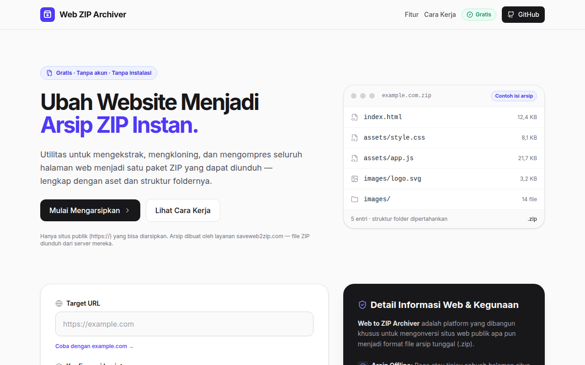

# Web ZIP Archiver

[](https://github.com/dezzorigin/web-zip-archiver/actions/workflows/ci.yml)
[](./LICENSE)

**Live demo: https://web-zip-archiver.pages.dev**

Ubah website publik apa pun menjadi satu file ZIP yang dapat diunduh —
lengkap dengan aset (CSS, JavaScript, gambar) dan struktur foldernya.
Gratis, tanpa akun, tanpa instalasi.



🎬 **Video demo (tur UI):** [docs/demo/demo.mp4](./docs/demo/demo.mp4)
— landing, pengisian form, dan status pemrosesan. Langkah kloning sampai
tombol unduh terverifikasi end-to-end oleh job CI `live-smoke`
(example.com → selesai, 2 file, ZIP asli) — lihat
[docs/DEPLOYMENT.md](./docs/DEPLOYMENT.md).

## Cara memakai

1. Tempel URL lengkap situs target (harus diawali `https://`).
2. Atur **Konfigurasi Lanjutan** bila perlu — biarkan default bila ragu.
3. Tekan **Mulai Proses Kloning**, pantau progress dan jumlah file.
4. Saat selesai, tekan **Unduh Archive ZIP**.

Detail lengkap: [docs/USER-GUIDE.md](./docs/USER-GUIDE.md)

## Kenapa mengarsipkan website?

- **Arsip Offline** — baca atau tinjau halaman tanpa internet aktif.
- **Audit Struktur Kode** — pelajari struktur aset dan implementasi
  HTML/CSS/JS dari URL publik target.
- **Backup & Pemulihan** — selamatkan tampilan halaman publik yang sedang
  live sebagai cadangan sementara.

## Cara kerja

```
Browser → Cloudflare Pages (static export)
   → POST /api/clone/start  → Pages Worker → copier.saveweb2zip.com/api/copySite → md5
   → GET /api/clone/status  → Pages Worker → copier.saveweb2zip.com/api/getStatus/{md5}
   → Unduh ZIP langsung dari copier.saveweb2zip.com/api/downloadArchive/{md5}
```

Crawling dan zipping dikerjakan oleh layanan **saveweb2zip.com** — repo ini
menyediakan antarmukanya dan proxy server yang dibutuhkan browser.
Arsitektur lengkap: [docs/ARCHITECTURE.md](./docs/ARCHITECTURE.md) ·
Diagram: [docs/diagrams/architecture.html](./docs/diagrams/architecture.html) ·
Kontrak API: [docs/API.md](./docs/API.md)

### Batasan (jujur)

- Hanya situs **publik (https)** yang bisa diarsipkan — situs yang butuh
  login atau memblokir crawler akan gagal, dan pesan error dari penyedia
  akan tampil apa adanya.
- Bila `copier.saveweb2zip.com` mati atau berubah API, tool ini ikut tidak
  bisa mengarsipkan (worker mengembalikan 502). Tidak ada crawling sendiri.
- Arsip disimpan sementara di server penyedia — unduh segera setelah selesai.

## Pengembangan lokal

```bash
npm install
npm run dev      # UI saja (http://localhost:3000) — /api/* belum aktif
npm run build    # static export ke out/ + salin worker
npm run preview  # preview lengkap (out/ + worker) di http://127.0.0.1:8788
npm test         # unit test worker (8 tes)
npm run typecheck
npm run lint
```

Catatan: `npm run dev` tidak melayani `/api/clone/*` — aplikasi ini static
export dan route handler dinamis tidak bisa ikut build (`output: 'export'`
menolaknya). Preview lengkap memakai `npm run preview`, dan produksi memakai
Pages Worker (`worker/_worker.js`). Lihat [docs/ARCHITECTURE.md](./docs/ARCHITECTURE.md).

## Dokumen

- [PRD v2.0](./docs/PRD.md) — tujuan, ruang lingkup, kriteria keberhasilan
- [ARCHITECTURE](./docs/ARCHITECTURE.md) — kenapa ada Worker, alur data
- [API](./docs/API.md) — kontrak `POST /api/clone/start` & `GET /api/clone/status`
- [USER-GUIDE](./docs/USER-GUIDE.md) — panduan pengguna
- [DEPLOYMENT](./docs/DEPLOYMENT.md) — cara deploy ke Cloudflare Pages
- [CHANGELOG](./docs/CHANGELOG.md) — riwayat perubahan

## Tech Stack

Next.js 15 (static export) · React 19 · Tailwind CSS 4 · Cloudflare Pages +
Pages Worker · TypeScript · ESLint · Lighthouse CI

## Lisensi

MIT — lihat [LICENSE](./LICENSE).

---
_Dikembangkan oleh **dezzorigin** (Nabil Aulia Dika)._
